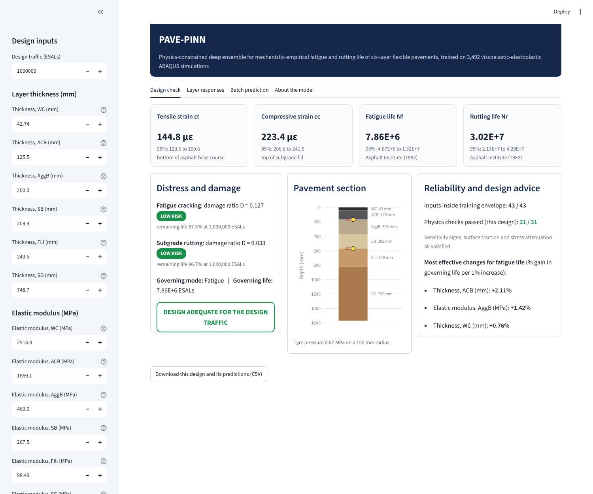

# PAVE-PINN

**Physics-constrained deep ensemble for mechanistic-empirical fatigue and rutting life of flexible pavements**

PAVE-PINN predicts the layer responses, the two critical strains and the fatigue and rutting lives of a six-layer flexible pavement from 43 design parameters. It was trained on 3,492 viscoelastic-elastoplastic ABAQUS simulations.



## What the app does

| Tab | Content |
|---|---|
| Design check | εt, εc, Nf, Nr with calibrated 95% intervals; damage ratios and risk level for the design traffic; governing mode; pavement section; physics checks for the current design; the three changes that raise the governing life most |
| Layer responses | All 6 × 11 layer-wise extreme responses; vertical stress and deflection against depth |
| Batch prediction | Upload a CSV/Excel file of designs and download the predictions |
| About the model | Definitions, transfer functions, accuracy, limitations, training ranges |

## Model

* **Inputs (43):** thickness, modulus, Poisson's ratio and density of the six layers (wearing course WC, asphalt base ACB, aggregate base AggB, subbase SB, subgrade fill Fill, natural subgrade SG); Drucker-Prager parameters φ, K, ψ, σy of the four unbound layers; tyre pressure P, temperature T, saturation S.
* **Network:**
  * a feature layer with 17 mechanistic descriptors;
  * a residual MLP of width 256 with 4 blocks;
  * an output layer with hard sign constraints;
  * a fixed mechanistic-empirical last layer.
* **Physics in training:** the surface traction, attenuation of stress and deflection with depth, and 29 audited sensitivity signs. The sensitivity signs are enforced by automatic differentiation at unlabelled collocation designs.
* **Critical strains:**
  * εt = EE11 + CE11 at the bottom of the asphalt base course (elastic + creep);
  * εc = |EE22| at the top of the subgrade fill.
* **Transfer functions (Asphalt Institute, 1982):**
  * Nf = 0.0796 εt^-3.291 E_ACB(psi)^-0.854
  * Nr = 1.365×10⁻⁹ εc^-4.477
  * Damage follows Miner's rule.
* **Uncertainty:** a five-seed deep ensemble. The 95% half-width in log10 units is h = q·√(sd² + s0²), calibrated on validation runs. Test coverage is 93.5–95.2%.
* **Test accuracy (525 held-out designs):** R² = 0.948 (εt), 0.982 (εc), 0.949 (log Nf), 0.989 (log Nr).

The app runs the trained ensemble in pure NumPy (`pave_pinn_core.py`), so it needs no PyTorch. `tests/test_model.py` checks that it reproduces the training-notebook predictions.

## Run locally

```bash
pip install -r requirements.txt
streamlit run app.py
```

## Deploy on Streamlit Community Cloud

1. Push this folder to a GitHub repository. Keep the folder structure as shown below.
2. Go to <https://share.streamlit.io>, sign in with GitHub, and click **Create app**.
3. Select the repository and branch, and set **Main file path** to `app.py`.
4. Click **Deploy**. The first build takes 2–4 minutes.

## Repository structure

```
app.py                      Streamlit app
pave_pinn_core.py           NumPy inference of the 5-member ensemble
model/
  pave_pinn_weights.npz     trained weights (5 networks)
  meta.json                 feature names, training ranges, calibration, physics rules
examples/sample_designs.csv five example designs for the batch tab
tests/                      reference predictions and test
requirements.txt
.streamlit/config.toml      theme
```

## Limitations

* Valid only inside the training ranges listed in the app. Inputs outside them are flagged.
* The load is a static uniform pressure on a 150 mm radius, and all layers are fully bonded. Moving loads, non-uniform contact stress and interface slip are not represented.
* Absolute lives inherit the Asphalt Institute calibration. Recalibrate them before using them for design.
* The model is validated against the finite element model, not against field measurements.

## Citation

Rind, T. A., Ahmed, S., Waqas, H. A. *PAVE-PINN: a physics-constrained deep ensemble for mechanistic-empirical life prediction of flexible pavements from 3,500 viscoelastic-elastoplastic finite element simulations.* Under review.

## License

The code is released under the MIT License. See `LICENSE`.

## Offline dashboard (GitHub Pages)

`docs/index.html` is a standalone version of the same model that runs entirely in the browser. To publish it, go to **Settings → Pages**, set the source to the `main` branch and the `/docs` folder, and open `https://<username>.github.io/<repo>/`.
